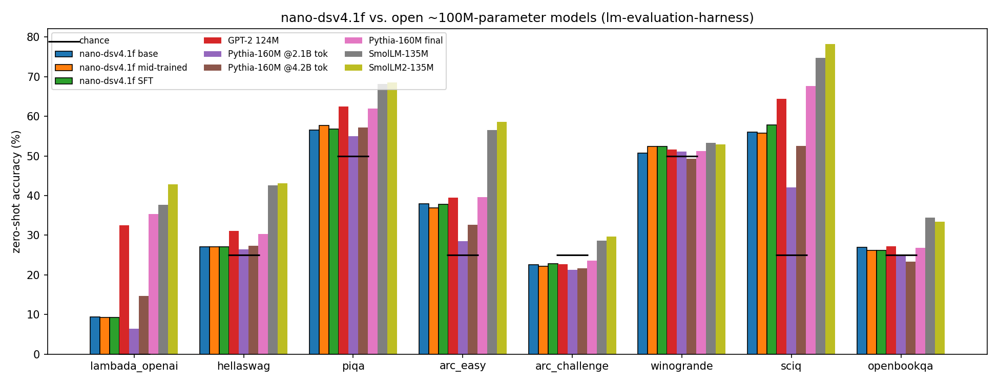

# Standard zero-shot benchmarks vs. open nano models

Status: **measured** (full test/validation sets, single run, zero-shot).

- Public notebook: [nano-dsv4.1f standard evals](https://www.kaggle.com/code/xiayicheng3gmailcom/nano-dsv4-1f-standard-evals), version 2.
- Harness: EleutherAI lm-evaluation-harness `0.4.13`, identical task configs for all models.
- Hardware: Kaggle GPU T4 ×2 (one model per GPU). Total evaluation time: 55 min.
- nano runtime: Torch port at `05c9613` (`codex/midtrain8k-sft16k`), FP32 on CUDA, dense
  backbone path; adapter in [`scripts/nano_lm_eval.py`](../../scripts/nano_lm_eval.py),
  notebook generated by [`scripts/build_eval_notebook.py`](../../scripts/build_eval_notebook.py).
- Raw metrics, standard errors, parameter counts and timings: [JSON](2026-11-01-standard-evals.json).

## Results

Accuracy in %, WikiText-2 in bits per byte (lower is better). The average covers the 8
accuracy tasks.

| Model | Train tokens | Non-emb. params | LAMBADA | HellaSwag | PIQA | ARC-E | ARC-C | WinoGrande | SciQ | OBQA | WikiText bpb ↓ | Avg |
|---|---|---|---:|---:|---:|---:|---:|---:|---:|---:|---:|---:|
| **nano-dsv4.1f base** | 2.4B (FineWeb-Edu) | 71M (11M active) | 9.4 | 27.0 | 56.6 | 37.9 | 22.5 | 50.7 | 56.0 | 27.0 | 1.308 | **35.9** |
| nano-dsv4.1f mid-trained | 2.76B | 71M (11M active) | 9.3 | 27.0 | 57.7 | 36.9 | 22.2 | 52.4 | 55.8 | 26.2 | 1.340 | 35.9 |
| nano-dsv4.1f SFT | 2.76B + 72M SFT | 71M (11M active) | 9.3 | 27.0 | 56.7 | 37.8 | 22.8 | 52.4 | 57.8 | 26.2 | 1.358 | 36.3 |
| Pythia-160M @ step1000 | 2.1B (Pile) | 85M | 6.5 | 26.5 | 55.0 | 28.5 | 21.3 | 51.1 | 42.1 | 24.8 | 1.358 | 32.0 |
| Pythia-160M @ step2000 | 4.2B (Pile) | 85M | 14.7 | 27.4 | 57.2 | 32.6 | 21.7 | 49.3 | 52.5 | 23.4 | 1.152 | 34.8 |
| GPT-2 124M | WebText | 86M | 32.6 | 31.1 | 62.5 | 39.5 | 22.7 | 51.6 | 64.4 | 27.2 | 0.977¹ | 41.5 |
| Pythia-160M final | 300B (Pile) | 85M | 35.4 | 30.3 | 61.9 | 39.6 | 23.6 | 51.2 | 67.7 | 26.8 | 0.944 | 42.1 |
| SmolLM-135M | 600B | 106M | 37.7 | 42.6 | 68.1 | 56.5 | 28.7 | 53.3 | 74.8 | 34.4 | 0.885 | 49.5 |
| SmolLM2-135M | 2T | 106M | 42.9 | 43.1 | 68.5 | 58.6 | 29.6 | 53.0 | 78.2 | 33.4 | 0.847 | 50.9 |

Metrics: LAMBADA and WinoGrande use `acc`. The other multiple-choice tasks use byte-length
normalized `acc_norm`, which does not depend on the tokenizer. Typical standard errors, in
percentage points: LAMBADA 0.4–0.7, HellaSwag 0.45, PIQA 1.1, ARC-E 1.0, ARC-C 1.2,
WinoGrande 1.4, SciQ 1.5, OBQA 2.0.
¹ GPT-2 rolling windows are 1024 tokens (its position limit). All other models use 2048.

## What the numbers say

1. **Against token-matched baselines, the base model wins.** At 2.4B tokens it averages
   35.9, versus 32.0 for Pythia-160M at 2.1B tokens and 34.8 at 4.2B tokens. It does this with fewer
   non-embedding parameters (71M total, about 11M active per token, vs. 85M dense).
2. **The gain is concentrated in knowledge QA.** ARC-Easy is 37.9 vs. 28.5 / 32.6 (about 7 and 4
   standard errors of the difference), and SciQ is 56.0 vs. 42.1 / 52.5. On ARC-Easy, ARC-Challenge and
   OpenBookQA the base model is within 1.6 points of GPT-2 124M, despite far less training.
3. **Narrative and cloze tasks are weak**, as expected from FineWeb-Edu pretraining.
   LAMBADA is 9.4% (perplexity 2510) and WikiText is 1.31 bpb. Pythia, trained on the Pile (which includes books
   and Wikipedia), overtakes it on LAMBADA and WikiText by 4.2B tokens. HellaSwag, which mostly
   measures commonsense continuation of everyday text, is near chance for every model trained on ≤4.2B tokens.
4. **Mid-training and SFT barely move the raw-LM benchmarks.** All changes are within
   about one standard error, apart from a small WikiText regression (1.308 → 1.358 bpb) as the data
   shifts toward code, math and conversation traces. These stages target reasoning and agent formats,
   which zero-shot log-likelihood tasks do not measure.
5. Models trained on 100–1000× more data (SmolLM/SmolLM2) set the ceiling for ~100M-parameter
   models at about 50 average. The remaining gap is mostly a training-budget gap.

## Validity checks

- **Runtime parity.** Before the run, Torch logits from the exported base weights were compared with
  the JAX training forward (`apply_model`, dense) on real text. Mean token NLL was 3.130 (Torch FP32)
  vs. 3.131 (JAX, BF16 payloads).
- **Grouped MoE.** The evaluation replaces the reference per-token expert-matrix gather
  (~3 MB of temporary memory per token) with one GEMM per selected expert. On each GPU run, its maximum
  absolute difference from the reference was below 2e-6 on every layer.
- **Padding.** Right-padded batched logits differ from unbatched logits by at most 1e-4.
- **Harness sanity.** GPT-2 124M reproduces its widely reported lm-eval numbers
  (LAMBADA 32.6, HellaSwag acc_norm 31.1).

## Caveats

- These are single runs on one seed, with no prompt tuning. Differences under about two standard errors are noise.
- Mid-training stopped after 0.36B of its planned 0.6B tokens (checkpoint `step-00085085`).
  The SFT checkpoint continues from that point.
- nano runs as a raw LM with a BOS prefix and no chat template. Sparse retrieval is not exercised:
  with a 512-entry Top-K and ≤2048-token windows, sparse and dense attention coincide.
- Parameter counts exclude input and output embeddings and the Engram lookup table (Pythia convention), and exclude
  the DSpark draft head.
